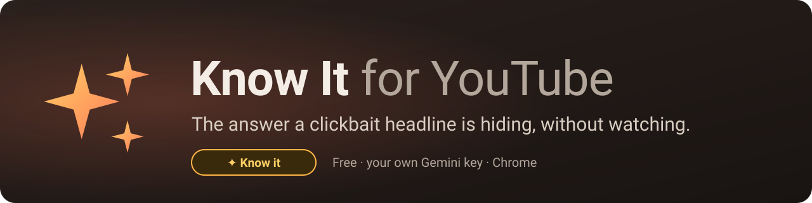
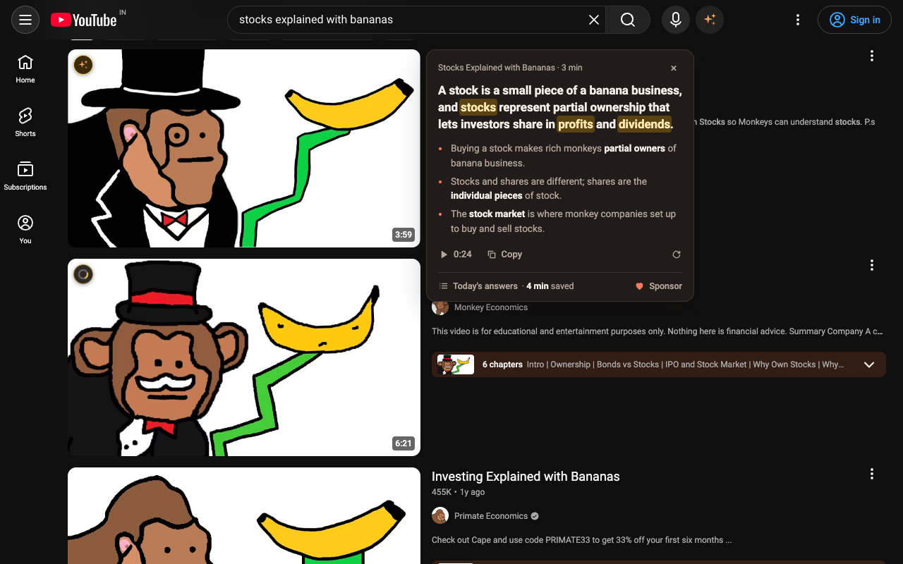
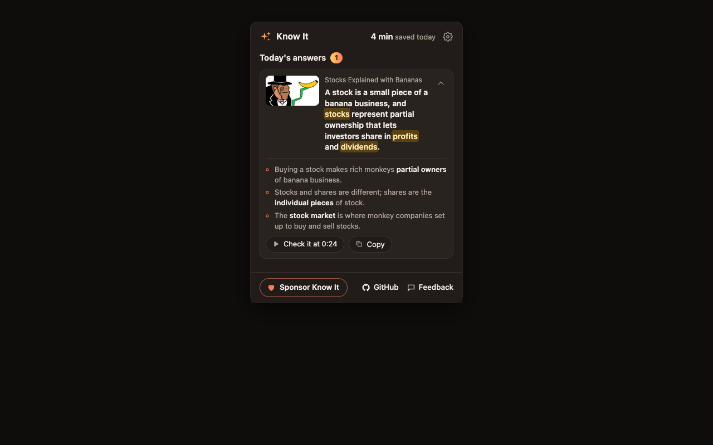

<p align="center">
  
</p>

<p align="center">
  <a href="https://github.com/arpitagarwal1301/youtube-summary/actions/workflows/ci.yml"></a>
  <a href="https://github.com/arpitagarwal1301/youtube-summary/releases/latest"></a>
  
  <a href="LICENSE"></a>
  <a href="https://github.com/sponsors/arpitagarwal1301"></a>
</p>

> "You won't believe which stock he picked." Now you will, without the 14 minutes.

**Know It** is a Chrome extension that answers a YouTube headline without opening the video. Point at a thumbnail, press **Know it**, and you get what the title is teasing: the movie name, the stock call, the price. One line, a few key points, and a timestamp to check it.

Gemini watches the video from its link, so no transcript is needed. Know It also reads the uploader's description and tags, which often name the film or song a headline hides. It runs on **your own free Gemini key**, which never leaves your browser except to go to Google.

<p align="center">
  
</p>

## Features

- ✨ **Know it on any thumbnail.** Home feed, search, the sidebar and Shorts shelves. The answer opens right beside the video.
- ▶️ **On the video you're watching.** A button just left of Like, and inside the Shorts player. The timestamp moves the player to the moment that backs up the answer.
- 📋 **Today's answers on YouTube.** A button beside the mic opens every answer from today, with the minutes Know It saved you.
- ⚡ **Auto-answer** *(off by default)*. Each video under 30 minutes you open is answered after 5 seconds.
- 🔔 **Carry on browsing.** A spinner stays on the thumbnail. When the answer is ready it pops up on the page, or as a desktop notification if YouTube isn't in view.
- 🧭 **Honest about doubt.** A quiet warning appears when the title oversells or a name may be a guess. Every answer has a **Check it at** link.
- 🔒 **Private by design.** No account, no server, no analytics. Videos go to Google's Gemini with your key, and nothing goes to the maker of Know It.
- 🌗 **Light and dark**, following YouTube's theme.

## Install

### From a release

1. Download **`know-it.zip`** from the [latest release](https://github.com/arpitagarwal1301/youtube-summary/releases/latest) and unzip it.
2. Open `chrome://extensions` and turn on **Developer mode**.
3. Click **Load unpacked** and pick the unzipped folder.

The Chrome Web Store listing is on its way.

### Get a Gemini key

Make a free key in [Google AI Studio](https://aistudio.google.com/apikey) and paste it into the welcome page, or into the popover the first time you press **Know it**.

> **EU, UK and Switzerland:** Google allows only paid keys there. Turn on billing for the key's project first, and Know It works the same.

## Using it

1. Point at a video on YouTube and press **Know it**.
2. Read the answer. **Summary** shows the rest, **Copy** shares it with the link.
3. Open the ✦ button beside YouTube's mic for today's answers. Settings are behind the ⚙ there.

Answers are kept for 24 hours, so reopening one is instant and free. **Ask again** gets a fresh answer.

<p align="center">
  
</p>

## How far to trust an answer

Answers come from an AI model and can be wrong, so use **Check it at** for anything that matters.

Gemini can't reliably name a film from faces. In testing it named a different wrong film on each try, at high confidence. So when a film or song name isn't in the video's title, tags, description or channel, Know It marks it as a possible guess. That warning can also appear when the name was only spoken or shown on screen and was right.

## Limits

- Gemini's free tier allows 8 hours of YouTube video a day, resetting at midnight Pacific time. Know It counts this itself and stops at the limit.
- Only public videos work. Private and unlisted videos, and live streams in progress, can't be answered.
- Free-tier rate limits can briefly refuse a request after several long videos. Waiting a minute clears it.
- The model is **Automatic**: Google's newest Flash-Lite, falling back to `gemini-3.1-flash-lite` when busy. You can pin another under **Settings → Advanced**.

## Privacy

| What | Where it goes |
|---|---|
| Your Gemini key | Stays in this browser. Sent only to Google with each request |
| The video's link, title, channel, description and tags | Google's Gemini API, when you press **Know it** or Auto is on |
| Saved answers and settings | This browser only, for 24 hours |
| Anything else | Nowhere. No analytics, no server, no account |

Read the full [privacy policy](store/privacy-policy.md).

## Build from source

Requires Node 22+.

```sh
git clone https://github.com/arpitagarwal1301/youtube-summary.git
cd youtube-summary
npm install
npm run build
```

Then load the `dist` folder with **Load unpacked**. See [CONTRIBUTING.md](CONTRIBUTING.md) for the checks and tests.

| Command | What it does |
| --- | --- |
| `npm run build` / `npm run watch` | Builds the extension into `dist`, once or on every change |
| `npm run typecheck` | Checks types |
| `npm test` | Runs the unit tests |
| `npm run test:e2e` | Runs the extension on real YouTube with a mock Gemini |
| `npm run test:real` | Runs the production build with the real Gemini, using one short video from your quota |
| `npm run check-docs` | Checks versions, changelog and links in the docs agree |
| `npm run package` | Builds and zips the extension into `know-it.zip` |
| `npm run store-screenshots` | Captures the store screenshots, using no API key |
| `npm run release -- <version>` | Tags and publishes a GitHub release. See [RELEASING.md](RELEASING.md) |

`test:real` and `try-videos` read your key from `.env.local` (`GEMINI_API_KEY=…`), which is never committed.

### How it works

- **`src/content`** draws the buttons and popover from one shadow root, laid over YouTube's page so its re-rendering can't remove them.
- **`src/background`** holds the key, saved answers and daily limit, reads the video page's details, and raises notifications.
- **`src/offscreen`** makes the Gemini request, which can outlast a service worker's 30-second limit.
- **`src/panel`** is today's answers and settings, and **`src/setup`** is the key form shown on YouTube.
- [`remote-config.json`](remote-config.json) is read once a day. It can change the models, YouTube selectors, links and a one-line notice, without a release. It holds data only, and every value is checked.

## More

- [Changelog](CHANGELOG.md): what's new in each version
- [Contributing](CONTRIBUTING.md) · [Releasing](RELEASING.md) · [Security](SECURITY.md)
- [Privacy policy](store/privacy-policy.md) · [Store listing](store/listing.md)
- [License](LICENSE): PolyForm Noncommercial 1.0.0 (noncommercial use; commercial use reserved)

## Support

Know It is free and made by one person. If it saves you time, [sponsor it on GitHub](https://github.com/sponsors/arpitagarwal1301) ♥. Found a bug or have an idea? [Open an issue](https://github.com/arpitagarwal1301/youtube-summary/issues/new/choose).

---

Built with ✨ by Arpit Agarwal. Not affiliated with or endorsed by YouTube or Google.
