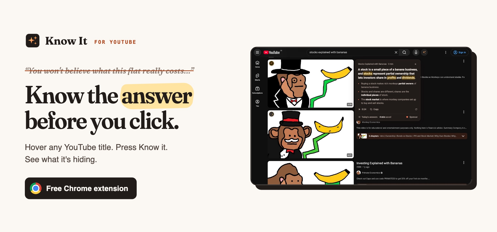
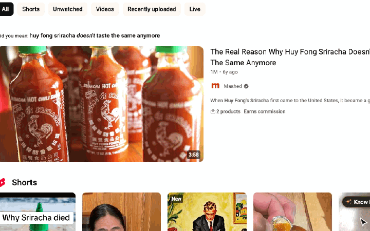
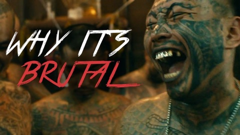
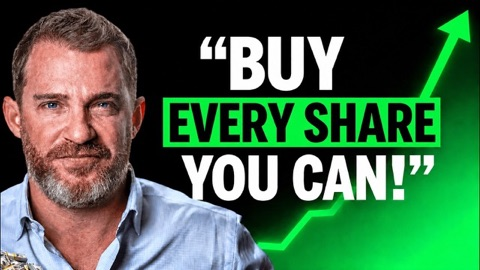
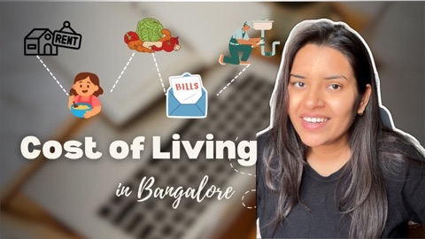
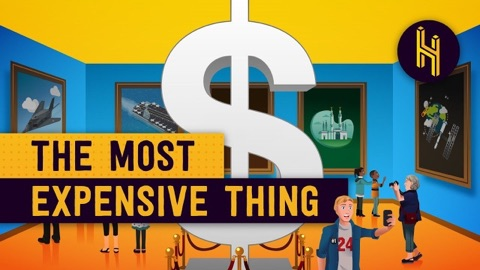
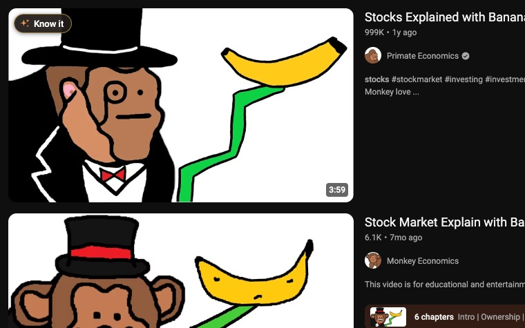
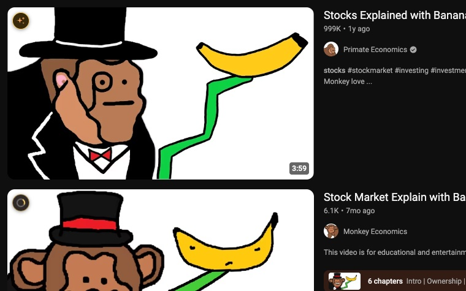
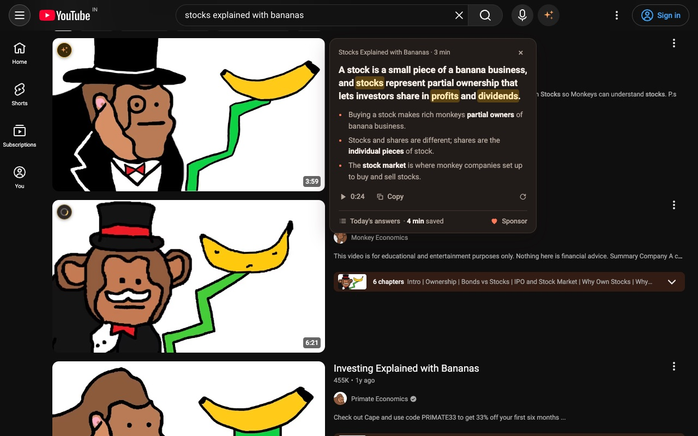

<picture>
  <source media="(prefers-color-scheme: dark)" srcset=".github/assets/readme/hero-dark.jpg">
  
</picture>

<p align="center">
  <a href="https://getknowit.github.io"><b>Website</b></a> ·
  <a href="#install"><b>Install</b></a> ·
  <a href="CHANGELOG.md"><b>Changelog</b></a> ·
  <a href="https://github.com/sponsors/arpitagarwal1301"><b>Sponsor ♥</b></a>
</p>

<p align="center">
  <a href="https://github.com/arpitagarwal1301/youtube-summary/actions/workflows/ci.yml"></a>
  <a href="https://github.com/arpitagarwal1301/youtube-summary/releases/latest"></a>
  
  <a href="LICENSE"></a>
</p>

**Know It** is a free Chrome extension that answers a YouTube headline without opening the video. Point at a thumbnail, press **Know it**, and you get what the title is teasing (the movie, the stock, the price) in one line, with a timestamp to check it.

It runs on **your own free Gemini key**. No account, no server, no analytics.

## See it work

<p align="center">
  
</p>

<p align="center"><sub>Real extension, real YouTube, real answer. Loading time shortened.</sub></p>

## Titles, answered

Six real clickbait titles, with the answers Know It gave. Open **Know it** under each one.

<table>
<tr>
<td width="33%" valign="top">
<a href="https://www.youtube.com/watch?v=2Qb8g-x9380"></a><br>
<b>The Best A24 Movie You've Never Seen</b><br>
<sub>The Kino Corner · 11:11 to find out</sub>
<details><summary>✦ <b>Know it</b></summary><br><b>A Prayer Before Dawn</b>, a brutal 2017 drama set in a <b>Thai prison</b>.</details>
</td>
<td width="33%" valign="top">
<a href="https://www.youtube.com/watch?v=NYUajUnq-gg"></a><br>
<b>Buy Every Share You Can: Nvidia CEO's New Favorite Stock Could 10X</b><br>
<sub>Ross Givens · 13:42 to find out</sub>
<details><summary>✦ <b>Know it</b></summary><br><b>ServiceNow</b> (<b>NOW</b>). The host thinks it can reach a <b>$1 trillion</b> valuation by 2030.</details>
</td>
<td width="33%" valign="top">
<a href="https://www.youtube.com/watch?v=N47fDCtRpKE"></a><br>
<b>Cost of Living in Flat in Bangalore 2025: The REAL Monthly Expense No One Tells You!</b><br>
<sub>Vanshika Vaishnav · 3:43 to find out</sub>
<details><summary>✦ <b>Know it</b></summary><br>About <b>₹20k to ₹25k a month per head</b>, sharing a 3BHK with flatmates.</details>
</td>
</tr>
<tr>
<td width="33%" valign="top">
<a href="https://www.youtube.com/watch?v=EM_oPEK5eZE"></a><br>
<b>The Real Reason Why Huy Fong Sriracha Doesn't Taste The Same Anymore</b><br>
<sub>Mashed · 3:58 to find out</sub>
<details><summary>✦ <b>Know it</b></summary><br>Huy Fong lost its pepper supplier, <b>Underwood Ranches</b>, after a legal fight, and switched peppers.</details>
</td>
<td width="33%" valign="top">
<a href="https://www.youtube.com/watch?v=Y-gVnj-NsuQ"></a><br>
<b>What's the Most Expensive Single Thing?</b><br>
<sub>Half as Interesting · 5:54 to find out</sub>
<details><summary>✦ <b>Know it</b></summary><br>The <b>International Space Station</b>, at about <b>$177 billion</b> adjusted for inflation.</details>
</td>
<td width="33%" valign="top">
<a href="https://www.youtube.com/watch?v=53ucZTDZPgA"></a><br>
<b>The One Habit That Makes You an Easier Target (Most People Do It Every Day)</b><br>
<sub>BulletProofBabes · 3:52 to find out</sub>
<details><summary>✦ <b>Know it</b></summary><br>Letting strangers inside <b>arm's length</b>. Keep that space around you.</details>
</td>
</tr>
</table>

## How it works

<table>
<tr>
<td width="33%" valign="top"><h3>01</h3><b>Add a free Gemini key</b><br>Get one from <a href="https://aistudio.google.com/apikey">Google AI Studio</a> in a minute. It stays in your browser.</td>
<td width="33%" valign="top"><h3>02</h3><b>Hover a thumbnail</b><br>A small <b>Know it</b> button appears. Press it and keep scrolling.</td>
<td width="33%" valign="top"><h3>03</h3><b>Read the answer</b><br>The film, the stock, the price, with a timestamp to check it in the video.</td>
</tr>
</table>

## Features

<table>
<tr>
<td width="42%" valign="middle">
<h3>On every thumbnail</h3>
Search, Home, Subscriptions, the sidebar and Shorts shelves. Hover a video and <b>Know it</b> is right there.
</td>
<td width="58%"></td>
</tr>
<tr>
<td width="58%"></td>
<td width="42%" valign="middle">
<h3>Ask a few, keep scrolling</h3>
A ring shows which are still working, a spark marks the ones that are ready. Answers that land while you're elsewhere pop up on the page, or as a desktop notification.
</td>
</tr>
<tr>
<td width="42%" valign="middle">
<h3>The point first, proof under it</h3>
One clear line with the key facts highlighted, a few supporting points, and <b>Check it at</b>, which jumps to the moment it's said. A quiet warning shows when a name might be a guess.
</td>
<td width="58%"></td>
</tr>
<tr>
<td width="58%"></td>
<td width="42%" valign="middle">
<h3>Today's answers</h3>
Everything you asked today and the minutes it saved you, from YouTube's top bar or Chrome's toolbar. Settings are behind the ⚙.
</td>
</tr>
</table>

**Also:** a button beside Like and inside the Shorts player · **Auto** answers videos under 30 minutes as you open them *(off by default)* · **Copy** shares an answer with its link · answers in your language · light and dark, following YouTube.

## Install

1. Download **`know-it.zip`** from the [latest release](https://github.com/arpitagarwal1301/youtube-summary/releases/latest) and unzip it.
2. Open `chrome://extensions` and turn on **Developer mode**.
3. Click **Load unpacked** and pick the unzipped folder.
4. Press **Know it** on any video and paste a free key from [Google AI Studio](https://aistudio.google.com/apikey).

The Chrome Web Store listing is on its way.

> **EU, UK and Switzerland:** Google allows only paid keys there. Turn on billing for the key's project first, and Know It works the same.

Answers are kept for 24 hours, so reopening one is instant and free. **Ask again** gets a fresh answer.

## How far to trust an answer

Answers come from an AI model and can be wrong, so use **Check it at** for anything that matters.

Gemini can't reliably name a film from faces. In testing it named a different wrong film on each try, at high confidence. So when a film or song name isn't in the video's title, tags, description or channel, Know It marks it as a possible guess. That warning can also appear when the name was only spoken or shown on screen and was right.

## Limits

- Gemini's free tier allows 8 hours of YouTube video a day, resetting at midnight Pacific time. Know It counts this itself and stops at the limit.
- Only public videos work. Private and unlisted videos, and live streams in progress, can't be answered.
- Free-tier rate limits can briefly refuse a request after several long videos. Waiting a minute clears it.
- The model is **Automatic**: Google's newest Flash-Lite, falling back to `gemini-3.1-flash-lite` when busy. You can pin another under **Settings → Advanced**.

## Privacy

| What | Where it goes |
|---|---|
| Your Gemini key | Stays in this browser. Sent only to Google with each request |
| The video's link, title, channel, description and tags | Google's Gemini API, when you press **Know it** or Auto is on |
| Saved answers and settings | This browser only, for 24 hours |
| Anything else | Nowhere. No analytics, no server, no account |

Read the full [privacy policy](store/privacy-policy.md).

## Build from source

<details>
<summary>Commands, tests and how the code is laid out</summary>

Requires Node 22+.

```sh
git clone https://github.com/arpitagarwal1301/youtube-summary.git
cd youtube-summary
npm install
npm run build
```

Then load the `dist` folder with **Load unpacked**. See [CONTRIBUTING.md](CONTRIBUTING.md) for the checks and tests.

| Command | What it does |
| --- | --- |
| `npm run build` / `npm run watch` | Builds the extension into `dist`, once or on every change |
| `npm run typecheck` | Checks types |
| `npm test` | Runs the unit tests |
| `npm run test:e2e` | Runs the extension on real YouTube with a mock Gemini |
| `npm run test:real` | Runs the production build with the real Gemini, using one short video from your quota |
| `npm run check-docs` | Checks versions, changelog and links in the docs agree |
| `npm run package` | Builds and zips the extension into `know-it.zip` |
| `npm run store-screenshots` | Captures the store screenshots, using no API key |
| `npm run release -- <version>` | Tags and publishes a GitHub release. See [RELEASING.md](RELEASING.md) |

`test:real` and `try-videos` read your key from `.env.local` (`GEMINI_API_KEY=…`), which is never committed.

#### How it works

- **`src/content`** draws the buttons and popover from one shadow root, laid over YouTube's page so its re-rendering can't remove them.
- **`src/background`** holds the key, saved answers and daily limit, reads the video page's details, and raises notifications.
- **`src/offscreen`** makes the Gemini request, which can outlast a service worker's 30-second limit.
- **`src/panel`** is today's answers and settings, and **`src/setup`** is the key form shown on YouTube.
- [`remote-config.json`](remote-config.json) is read once a day. It can change the models, YouTube selectors, links and a one-line notice, without a release. It holds data only, and every value is checked.

</details>

## More

- [Changelog](CHANGELOG.md): what's new in each version
- [Contributing](CONTRIBUTING.md) · [Releasing](RELEASING.md) · [Security](SECURITY.md)
- [Privacy policy](store/privacy-policy.md) · [Store listing](store/listing.md)
- [License](LICENSE): PolyForm Noncommercial 1.0.0 (noncommercial use; commercial use reserved)

## Support

Know It is free and made by one person. If it saves you time, [sponsor it on GitHub](https://github.com/sponsors/arpitagarwal1301) ♥. Found a bug or have an idea? [Open an issue](https://github.com/arpitagarwal1301/youtube-summary/issues/new/choose).

---

Built with ✨ by Arpit Agarwal. Not affiliated with or endorsed by YouTube or Google.
