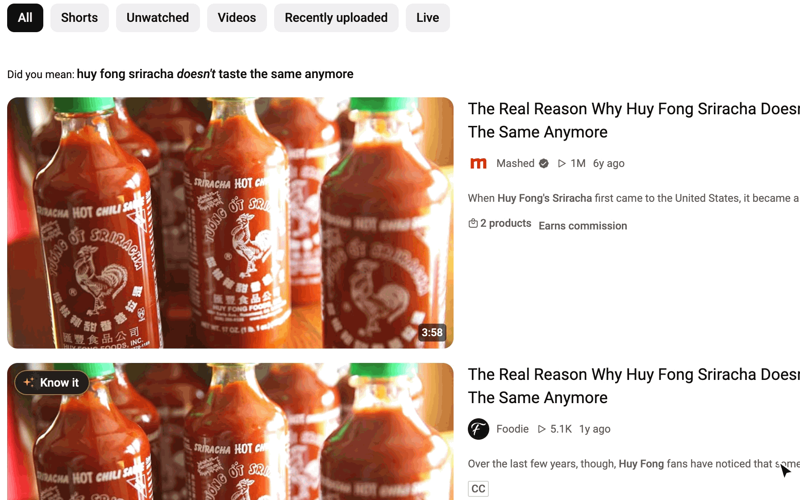
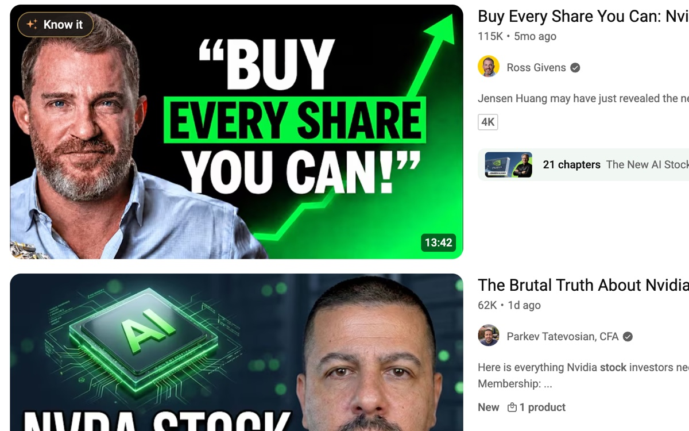
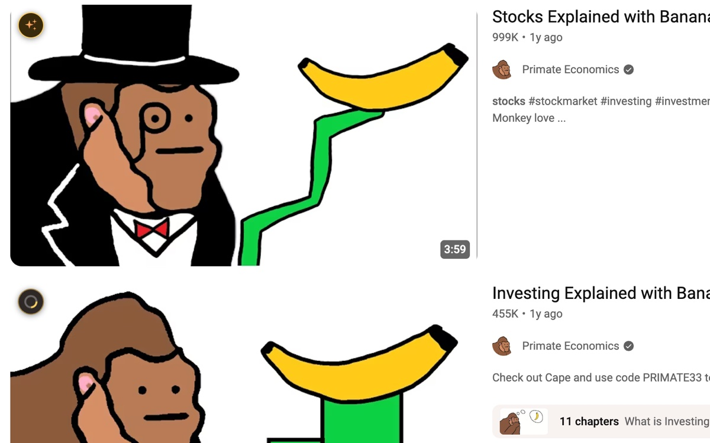
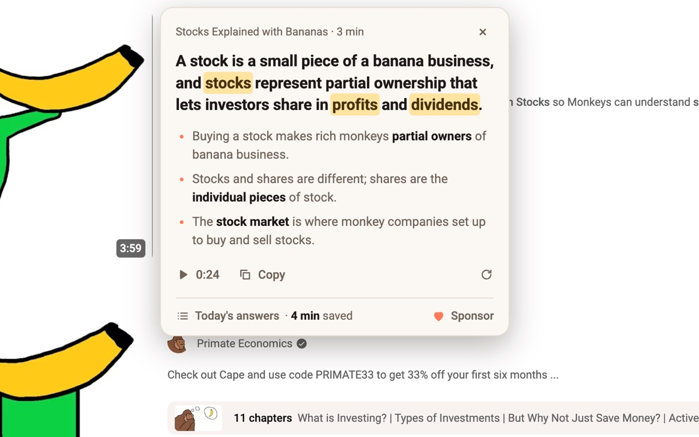
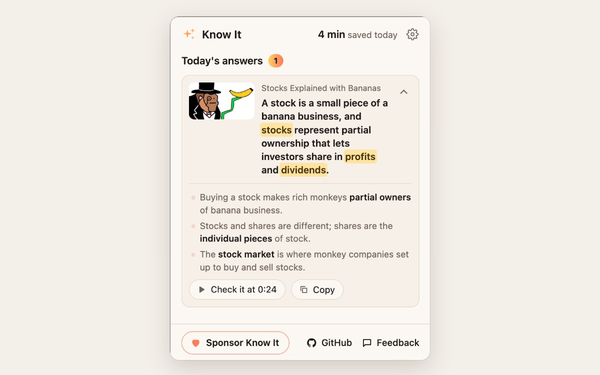

<picture>
  <source media="(prefers-color-scheme: dark)" srcset=".github/assets/readme/hero-dark.jpg">
  
</picture>

<p align="center">
  <a href="https://chromewebstore.google.com/detail/know-it-for-youtube/nilkfcjmledjkedlljnggfohkpbibigc"><b>Add to Chrome</b></a> ·
  <a href="https://getknowit.github.io">Website</a> ·
  <a href="CHANGELOG.md">Changelog</a> ·
  <a href="https://github.com/sponsors/arpitagarwal1301">Sponsor ♥</a>
</p>

**Know It** is a free Chrome extension that answers a YouTube headline without opening the video. Point at a thumbnail, press **Know it**, and get what the title is teasing (the movie, the stock, the price) in one line, with a timestamp to check it.

It runs on your own free Gemini key. No account, no server, no analytics.

## See it work

<picture>
  <source media="(prefers-color-scheme: dark)" srcset=".github/assets/readme/demo-dark.gif">
  
</picture>

## Titles, answered

Real answers Know It gave, not written by hand.

| The title asks… | Know It says |
|---|---|
| [The Best A24 Movie You've Never Seen](https://youtu.be/2Qb8g-x9380) | **A Prayer Before Dawn**, a 2017 drama set in a Thai prison. |
| [Buy Every Share You Can: Nvidia CEO's New Favorite Stock Could 10X](https://youtu.be/NYUajUnq-gg) | **ServiceNow** (NOW), which the host thinks can reach $1 trillion by 2030. |
| [Cost of Living in Flat in Bangalore 2025](https://youtu.be/N47fDCtRpKE) | About **₹20k to 25k a month** per head, in a shared 3BHK. |
| [Why Huy Fong Sriracha Doesn't Taste The Same Anymore](https://youtu.be/EM_oPEK5eZE) | Huy Fong lost its pepper supplier, **Underwood Ranches**, after a legal fight. |
| [What's the Most Expensive Single Thing?](https://youtu.be/Y-gVnj-NsuQ) | The **International Space Station**, at about $177 billion. |

## What you get

<table>
  <tr>
    <td width="50%" valign="top">
      <picture>
        <source media="(prefers-color-scheme: dark)" srcset=".github/assets/readme/button-dark.jpg">
        
      </picture>
      <b>On every thumbnail.</b> Hover a video in search, Home or the sidebar and <b>Know it</b> is right there. Also beside Like and in Shorts.
    </td>
    <td width="50%" valign="top">
      <picture>
        <source media="(prefers-color-scheme: dark)" srcset=".github/assets/readme/loading-dark.jpg">
        
      </picture>
      <b>Keep scrolling.</b> Ask about a few. A ring shows the ones still working, a spark marks the ones that are ready.
    </td>
  </tr>
  <tr>
    <td width="50%" valign="top">
      <picture>
        <source media="(prefers-color-scheme: dark)" srcset=".github/assets/readme/answer-dark.jpg">
        
      </picture>
      <b>The point first.</b> One clear line, the key facts highlighted, a few points, and a timestamp that jumps to the moment it's said.
    </td>
    <td width="50%" valign="top">
      <picture>
        <source media="(prefers-color-scheme: dark)" srcset=".github/assets/readme/panel-dark.jpg">
        
      </picture>
      <b>Today's answers.</b> Everything you asked today and the minutes it saved you, from YouTube's top bar or Chrome's toolbar.
    </td>
  </tr>
</table>

**Auto** *(off by default)* answers videos under 30 minutes 5 seconds after you open them.

## Install

1. Add [Know It from the Chrome Web Store](https://chromewebstore.google.com/detail/know-it-for-youtube/nilkfcjmledjkedlljnggfohkpbibigc).
2. Press **Know it** on any YouTube video and paste a free key from [Google AI Studio](https://aistudio.google.com/apikey).

In the EU, the UK and Switzerland, Google only allows paid keys: turn on billing for the key first.

Prefer the zip? Download `know-it.zip` from the [latest release](https://github.com/arpitagarwal1301/youtube-summary/releases/latest), unzip it, open `chrome://extensions`, turn on **Developer mode**, click **Load unpacked** and pick the folder.

## Good to know

- Answers come from an AI model and can be wrong. Use **Check it at** for anything that matters. When a film or song name might be a guess, Know It says so.
- Gemini's free tier covers 8 hours of video a day. Only public videos work.
- Your key and answers stay in your browser. Only the video you ask about (its link, title, channel, description and tags) goes to Google. Read the [privacy policy](store/privacy-policy.md).

## Build from source

```sh
npm install
npm run build    # then Load unpacked the dist folder
npm test
```

[CONTRIBUTING.md](CONTRIBUTING.md) has every command, how the code is laid out, and the checks to run. [RELEASING.md](RELEASING.md) covers releases.

---

<sub>[PolyForm Noncommercial 1.0.0](LICENSE) · [Security](SECURITY.md) · Made by Arpit Agarwal · Not affiliated with YouTube or Google.</sub>
